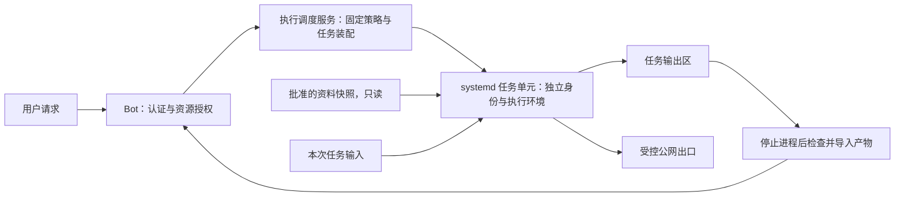

# Linux 执行隔离：范围内默认放行

日期：2026-09-07。状态：**实施设计，尚未实现或部署**。

本文确定下一阶段普通用户脚本执行的边界。当前代码中的 `relaxed` 仍是宿主机执行前调用独立模型审查；本文不会让现有模式自动变成沙箱。当前权限字段见[配置指南](../guide/configuration.md#身份与动作授权)，历史决策见[动作授权方案](action-authorization-capabilities.md)。

## 1. 决策与目标

对搜索、站内搜图、固定资料目录 grep、计算和文件转换，使用 **Linux 内核限制执行范围，范围内默认执行**。普通脚本不再逐次等待风险模型批准，不按命令名建立功能白名单。是否使用 Python、shell 或陌生库，本身不构成拒绝理由。

保留两层独立检查：

| 层级 | 决定的事情 | 例子 |
|---|---|---|
| 应用授权 | 发起者、数据归属、目标聊天、资源集合 | 可以查哪些群的历史、可读哪个资料集合、可向谁发送结果 |
| Linux 执行隔离 | 进程实际能访问什么、消耗多少资源 | 只读资料挂载、任务目录可写、受控公网、内存及进程上限 |

管理员名单属于 `authorization.admins`，聊天信任域属于 `authorization.chat_domains`，Person 关联属于 `identity`。共享历史、脚本执行模式和跨群发送是不同权限。无需为每个 QQ 成员创建常驻 Linux 用户；应用身份映射到本次任务的资源授权，任务执行身份由系统管理。

预期体验是“帮我在 FrozenProjects 搜索并整理结果”直接完成；读取 bot 密钥时由内核拒绝。用户想表达善意、模型声称安全，均不能扩大已装配的执行环境。

## 2. 已核实的服务器基础

2026-09-07 对既有服务器做过只读检查，观察到：

| 项目 | 结果 |
|---|---|
| Linux | `6.8.0-90-generic` |
| systemd | `255 (255.4-1ubuntu8.17)` |
| cgroup | v2，挂载类型 `cgroup2fs` |
| LSM 列表 | 包含 Landlock、AppArmor |
| 启动工具 | 已有 `/usr/bin/systemd-run`；当时 PATH 未找到 `bwrap` |
| 检查时登录账号 | `ecs-user`，UID 1000 |

这说明具备实施基础，不代表隔离已生效。上线前仍须检测实际 Landlock ABI、可用 cgroup controller、namespace/LSM 限制，以及执行服务安装权限。不能只从版本号推断全部能力可用。没有在该次检查中创建用户、安装软件、修改权限或重启服务。

## 3. 威胁范围

隔离对象是模型生成或用户要求运行的脚本，包括它启动的子进程、下载的代码和依赖。不信任脚本对路径、网络目的地、退出状态及输出文件类型的描述。

需要阻止脚本读取生产数据库和凭据、修改 bot/系统文件、操作其他任务、访问宿主管理接口，以及耗尽资源。不依赖脚本是否具有“明显恶意”；误操作同样受限制。

不承诺防御内核漏洞、已攻陷的宿主 root 或 bot 主进程。脚本可以读的输入如果同时允许联网，原则上就可能被外传。公开联网任务只提供可公开或明确允许外传的数据；敏感输入的处理使用离线任务配置。Linux 权限无法判断公开网站上的行为是否符合业务意图，也无法限制远端 MCP 服务自身持有的权限。

## 4. 进程与权限分工

### Bot 主进程

继续持有会话、身份、发送通道及必要服务凭据。完成应用授权后，提交命令内容、输入文件句柄和资料集合 ID；不把配置、整个工作区或进程环境顺手传给执行器。脚本通过 stdout、stderr 和产物返回结果，发送消息由 Bot 再按原聊天范围处理。

### 执行调度服务

部署时安装一个 root 管理、接口很小的服务，用固定模板装配任务。请求接口只向指定 Bot 进程账号开放；任务内不暴露该 socket、systemd D-Bus、Docker socket 或服务凭据。

请求者不能提交任意 unit 属性、宿主挂载路径、UID、capability 或网络 namespace 路径。资料集合 ID 映射到管理员预先声明的目录，任务 ID 由服务生成。未知集合、缺失可信发起者或不合法参数在启动前失败。服务不通过宿主 shell 拼接并执行模型命令；命令文本只在受限任务内解释。

**不向 Bot 授予任意 `sudo systemd-run`、`sudo bash` 或任意启动 root 单元的权限。** 服务的特权部分仅负责固定模板的启动和回收，不能成为任意 root 执行入口。

### 任务执行身份

优先使用每个任务单元独立的 `DynamicUser`，配合独立文件视图与工作目录。运行时 UID 不承担长期文件所有权；任务停止、进程清空后，调度服务将合格输出复制到按应用身份管理的产物区，再清理临时文件。不能遗留由动态 UID 拥有的共享可访问目录，防止 UID 回收后误授权。systemd 提供动态用户与相应临时目录管理机制，但仍需正确设计持久化输出。[systemd 255 执行文档](https://github.com/systemd/systemd/blob/v255/man/systemd.exec.xml)

## 5. 文件系统与进程边界

为任务准备最小的只读运行环境，包含 shell、Python、grep/rg、证书和已批准依赖；通过独立根目录/挂载视图装配，不直接把整个宿主 `/` 交给脚本。

| 任务内视图 | 权限与来源 |
|---|---|
| 运行环境 | 只读，部署者维护；模型不能替换宿主解释器或启动器 |
| `/refs/<collection>` | 已批准资料快照，只读；不包含凭据与私有文件 |
| `/input` | 本次任务授权输入的副本，只读 |
| `/work` | 本任务可读写，受容量约束 |
| `/tmp` | 本任务临时空间，有容量上限 |
| `/output` | 本任务输出区，导出前进行检查 |
| bot 的家目录、代码、配置、DB、socket | 不挂载，不通过其他路径或已打开句柄提供 |
| 其他任务目录和进程信息 | 不可访问；不同任务不可共用有残留状态的解释器 |

使用 `NoNewPrivileges`、清空 capability 集合、受限设备和进程视图，以及按运行环境验证的 syscall 策略。禁止可改变隔离状态的特权操作；允许的普通程序和动态代码仍须受同一环境限制。systemd 的只读与不可访问路径配置语义不同：只读挂载不能防止读取秘密。[systemd 255 安全与执行配置](https://github.com/systemd/systemd/blob/v255/man/systemd.exec.xml)

启动环境使用显式最小变量集，不继承 Bot 的 API key、代理认证、SSH agent、云凭据、登录 cookie 或敏感文件描述符。需要联网的代理配置只能指向任务可使用的专用出口，不能复用 Bot 的带权限代理账号。禁止向任务暴露宿主 `/proc` 的敏感视图和控制 socket；`/dev` 只保留运行需要的安全设备。

Python 依赖可以在任务内安装到可丢弃的可写目录，安装过程同样受网络和资源限制。跨任务缓存只接受受信任的只读缓存或完成明确校验的条目，不能让一个用户修改解释器、依赖或缓存后影响下一位用户。

### Landlock 的位置

Landlock 作为进程降权后的额外限制，可限定文件层级访问，并由后代进程继承。必须在执行不可信代码之前施加规则，先处理环境与继承句柄；施加规则前已打开的文件不自动获得同样的限制。按实际 ABI 装配规则并测试，不把系统“启用了 Landlock”当作任务已被限制。[Linux 6.8 Landlock 文档](https://www.kernel.org/doc/html/v6.8/userspace-api/landlock.html)

首版主要边界仍是任务身份、文件视图、网络环境及 cgroup；Landlock 可以按可检测的部署配置叠加。如果部署策略声明某项隔离是必需条件，检测或装配失败时拒绝启动，不能忽略失败继续运行。

## 6. 联网方案：可搜索公网，不能接触宿主内网

定义两种固定任务网络配置：

- `offline`：无外部网络；用于不需要搜索或包含敏感输入的任务。
- `public_web`：允许通过受控出口访问公开 HTTP/HTTPS，用于搜索、图片页面与常见 CDN；不要求每个普通网站都人工加入白名单。

任务置于独立网络 namespace；`public_web` 只允许连接出口代理，不能直连互联网、宿主服务或其他任务。出口在任务之外解析域名，并检查 IPv4/IPv6 目的地址、重定向及连接时的实际目标，拒绝环回、私网、链路本地、云元数据等地址。出口自身不得通过 CONNECT、DNS 重绑定或其他代理协议变成内网跳板。网络 namespace 提供独立的网络设备、路由和端口等视图；具体访问规则仍需显式配置。[Linux 网络 namespace 文档](https://www.man7.org/linux/man-pages/man7/network_namespaces.7.html)

`HTTP_PROXY` 等环境变量只是给正常程序使用出口的便利方式，不能作为强制措施；脚本可能忽略它们。禁止直接出站必须落实到 namespace 路由与防火墙，同时覆盖 IPv6、UDP、DNS 和其他协议。浏览器需要的普通网页/CDN流量走同样的出口，不能自动复用宿主浏览器身份。

Linux 6.8 的 Landlock 网络规则围绕 TCP 端口，不能靠“允许 443”实现公网/内网区分，因此不把它作为域名与地址过滤器。[Landlock 网络规则](https://www.kernel.org/doc/html/v6.8/userspace-api/landlock.html)

## 7. 资源、生命周期与产物

建议首轮参数如下，均为待压测起点，不是已经实现的配置字段：

| 项目 | 起始值 |
|---|---|
| 每任务内存硬上限 | 512 MiB |
| 每任务 CPU 配额 | 1 个 CPU 的额度 |
| 每任务进程/线程总量 | 64 |
| 每次执行墙钟时间 | 30 秒；较重任务使用部署者声明的独立配置 |
| 每账号同时运行数 | 2；另设全局上限和有界队列 |
| 可写空间总量 | 100 MiB，计入临时文件与输出 |
| stdout/stderr | 流式捕获，分别限制累计字节，不能等 communicate 完才截断 |

cgroup 的 CPU、内存和进程控制用于约束整组进程，而非只约束最外层 shell；具体 controller 必须在启动前可用并验证。磁盘空间另用有界 tmpfs、配额或受控卷落实，不能将内存限制视为磁盘限制。[Linux cgroup v2 文档](https://www.kernel.org/doc/html/v6.8/admin-guide/cgroup-v2.html)、[systemd 255 资源控制](https://github.com/systemd/systemd/blob/v255/man/systemd.resource-control.xml)

超时、取消、Bot 断线、执行服务重启均按任务单元回收；正常 shell 退出时也必须检查并终止后台残留进程。回收整个任务 cgroup，确认空后再导入产物和移除挂载/临时目录。执行器启动时对账未完成任务，不能让断开的请求留下常驻脚本。

导入产物仅接受任务输出根下的普通文件。拒绝符号链接、设备、FIFO、socket 和超限文件，限制文件数、单文件大小和解包后的总量；不对输出路径进行宿主命令求值。采用目录句柄相对打开和 `openat2` 的路径解析约束等方式控制越界、magic link 与竞态，不使用“先 resolve，随后另一次按路径打开”作为完整保证。[openat2 路径解析约束](https://www.man7.org/linux/man-pages/man2/openat2.2.html)

产物记录 owner 账号、来源聊天、任务 ID 和允许共享范围。尚未发送的私人产物不会因处于同一聊天域就自动共享。产物内容与脚本输出均作为不可信数据进入后续上下文，不作为系统指令、技能或宿主自动执行文件加载。

## 8. 与现有代码衔接

以下是下一阶段计划，不在本次字段迁移中修改运行行为：

| 当前触点 | 计划调整 |
|---|---|
| `plugins/builtin/commands.py` 的 `_tool_exec` | 委托统一执行服务，不直接为普通用户创建宿主 shell |
| `scheduler/script_executor.py` 的 `execute_script` | 与即时 exec 使用同一个执行后端，不另留宿主捷径 |
| `scheduler/service.py` | 每次触发重新检查真实发起者与资源范围，再选择执行环境；拒绝不转为可绕过的 Agent fallback |
| `agent/orchestration` | 子任务继承父任务允许的资源范围并只能缩小；复用账号/全局预算，不因另开子进程重置额度 |
| `identity/authorization.py` | 根据实际执行后端和服务器产生的执行上下文决定是否免审，不能仅凭工具名/模型参数宣称已隔离 |
| workspace 文件与附件工具 | 使用同一产物/资源服务；不能让脚本受限却从主进程文件 API 访问整个旧工作区 |
| MCP 与 Desktop 工具 | 本地隔离不能覆盖远端权限或 Windows 节点；保留其应用授权与独立执行策略 |

2026-09-14 已落地一个最小前置切片：`exec` 与 cron 外部命令默认运行在独立 venv（`core/exec_env.py`，配置 `exec_venv_path`），模型脚本的 `pip install` 不再能改动 bot 自身依赖；同时 exec 输出固定报告实际工作目录（issue #58）。这只是环境分离与可见性——同一 OS 用户、同一文件系统的访问能力不变，不构成本文定义的任何隔离边界。

新后端上线后，`relaxed` 的日常执行路径变为“应用范围检查 → 受限任务 → 返回结果”，不再默认调用风险模型。审查可用于少数需要扩大范围的请求或异步审计；异步审计只能发现和追踪，不能撤回已发生的副作用。

`unsafe` 保留为部署者明确选择的宿主执行路径，必须在配置、日志与实际后端中可区分。隔离服务不可用或平台不支持时返回 `isolation_unavailable`，不能自动降级 unsafe，也不能只跳过旧管理员检查却仍执行原来的宿主 shell。

现有已配置为 relaxed 的部署切换后端时，需要明确发布说明与就绪检查；实现未完成前不改变其模式含义，也不从配置名称宣称存在隔离。

## 9. 延迟与可观测性

目标是移除每次脚本执行的一次 LLM 网络往返。只读检索等当前免审工具本来就没有这部分开销，不能将其也计为收益。

分别记录排队、环境装配、实际执行、产物导入和清理耗时，比较冷启动、连续调用与并发时的 p50/p95。对 grep、小 Python、站内图片查询/下载各做相同输入的基线测试。目标可设为短任务装配 p95 不超过 500 ms，但必须用服务器实测调整，不能宣称已达到。

优先缓存只读运行环境和依赖，不跨用户复用有可写残留的解释器。若未来使用预热池，领取前和回收后须重新验证身份、挂载、网络和无残留进程；性能优化不能扩大隔离范围。

审计记录账号、聊天、任务 ID、策略/运行环境版本、资料集合、网络配置、实际后端、结果状态和资源消耗。命令内容是否保留沿用明确的日志策略并做敏感处理；不新增凭据或输入文件全文日志。区分应用权限拒绝、文件/网络限制、资源耗尽、环境不可用和普通程序错误。

## 10. 实施顺序与验收

1. **平台探测与固定启动模板**：准备受信任运行环境、调度服务和最小接口；验证缺少必要能力时停止启动。安装阶段需要部署者权限，日常调用不取得通用 root 权限。
2. **离线执行闭环**：完成输入副本、只读资料、私有工作区、资源限制、全组回收和产物导入。用隔离外的哨兵文件检查读写均无法越界。
3. **受控公网出口**：验证普通网站/图片 CDN 可用，同时检查直连、私网 IPv4/IPv6、环回、云元数据、重定向和 DNS 重绑定不能绕过出口。
4. **所有入口统一**：即时 exec、定时脚本、子代理和主进程文件工具共同使用明确资源范围。已通过隔离就绪验证的日常脚本才移除逐次模型审查。
5. **按指定群试运行**：观察真实任务完成率、拒绝分类和延迟，不自动扩大到所有群。回退到 standard 或停用执行后端，不能以回退名义开放宿主 shell。

上线门槛覆盖正常任务和反例：

| 场景 | 验收要求 |
|---|---|
| 固定目录 grep、Python 统计、生成 CSV | 成功，无风险模型调用 |
| 公开网站搜图和下载 CDN 图片 | 成功，不继承管理员 cookie/凭据 |
| 读取生产 DB、环境密钥、宿主 SSH agent 或 socket | 被实际环境阻止 |
| 文件链接、相对路径、输出路径替换、特殊文件 | 不越界，不在主进程产生副作用 |
| 同时运行不同用户任务 | 不可互读文件、探查敏感进程信息或影响对方执行 |
| 忽略代理直连、IPv6/UDP/DNS 出口绕过 | 被网络层阻止 |
| 大量派生进程、无限输出、超量写文件、超时 | 受限制且整个任务回收 |
| 子代理、定时脚本、脚本失败后的替代路径 | 不扩权、不改走宿主后端 |
| 服务断线/重启、身份撤回、动态 UID 复用 | 不遗留可继续执行的任务或可误读的旧输出 |
| 沙箱或必要保护不支持 | 返回环境不可用，绝不静默降级 |

本轮只记录设计，不安装服务、不创建 Linux 用户、不修改服务器权限，不移除当前风险审查实现。
