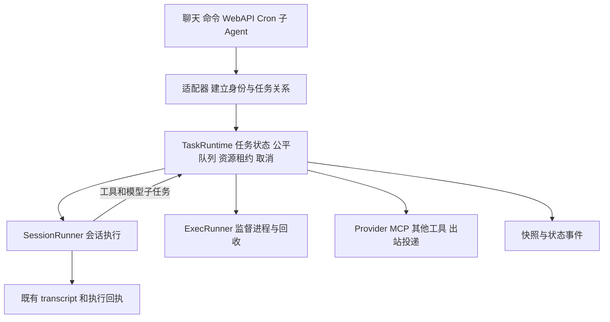

# 统一任务运行时设计方案

> 状态：设计草案；2026-11-04 已实现首批 exec 准入与超时改动，范围见第 16 节
> 日期：2026-11-03
> 关联：[#65](https://github.com/AI1379/nahida-bot/issues/65)
> 代码基线：`v2` 的 `acf3fff` 与当前工作区的会话请求边界改动

为聊天、命令、Cron、子 Agent 和插件工具提供统一的任务归属、资源准入、排队与取消机制。保留 `SessionRunner`、`ExecRunner`、Provider 和 MCP 等执行后端，逐步收回分散的并发与生命周期控制。

首批迁移覆盖共享 exec 预算和会话独占。随后接入子 Agent、工具并行、模型与远端服务限流，最后引入需要恢复能力的持久任务。运行时负责决定何时启动工作以及如何结束工作；任务内容和工具选择仍由 Agent 与业务代码决定。

## 1 核心决策

1. 区分逻辑任务、执行尝试和资源租约。一个等待子任务的 Agent 仍然存在，但不因此占用 exec 或模型请求额度。
2. 会话独占与执行资源分开管理。同一会话从读取历史到提交本轮记录保持独占；exec、Provider、MCP 等按各自资源键调度。
3. 排队有界。任务数量、等待时间和待处理载荷均有上限，不能把 `busy` 换成无限等待。
4. 一项资源只有一个准入控制者。切换后的共享 exec 额度由运行时维护，执行器保留资源保护和进程回收，不再叠加另一套排队信号量。
5. 父子关系分别表达来源、等待关系与取消归属。现有后台子 Agent 保持后台语义；普通工具属于当前 run。
6. 取消分为请求停止、执行中断、清理和终态确认。保留部分 transcript、工具回执与历史记录的路径，不用直接取消外层会话协程替代这些步骤。
7. 首版使用单进程 asyncio 协调器。SQLite 用于既有业务账本；持久队列和恢复协议独立分期，不引入调度服务集群。

本方案不承诺任意 Python 协程、线程、远端请求或 shell 命令的暂停续跑。长驻 sidecar 继续由 `ProcessSupervisor` 监管。Linux 执行隔离按[既有方案](linux-execution-isolation.md)推进，调度额度不代替内核隔离。

## 2 当前代码与迁移起点

以下是 2026-11-03 设计起点的实现，不将旧设计文档中的接口视为已经存在；后续落地状态见第 16 节。

| 位置 | 当前职责和行为 | 对迁移的约束 |
|---|---|---|
| [`core/tasks.py`](../../nahida_bot/core/tasks.py) 的 `TaskManager` | 命名、owner、后台协程启动与关闭；`spawn` 立即启动 | 保留基础设施任务管理；不直接承担业务准入 |
| [`core/exec_runner.py`](../../nahida_bot/core/exec_runner.py) 的 `ExecRunner.run` | 全局信号量；额度不足直接 `busy`；监督进程负责采样与回收 | 第一处可收敛的共享资源边界 |
| [`builtin/commands.py`](../../nahida_bot/plugins/builtin/commands.py) 与 [`scheduler/script_executor.py`](../../nahida_bot/scheduler/script_executor.py) | 工具、命令、Cron 脚本复用应用 runner；独立构造时存在创建 runner 的兜底 | 应用内必须注入同一入口，禁止兜底产生独立额度 |
| [`core/router.py`](../../nahida_bot/core/router.py) | 普通 Agent 运行登记 tracker；忙时进入 pending 队列；控制命令可先执行 | 原始消息、steer、批次和回复锚点由路由层保留 |
| [`core/message_batch.py`](../../nahida_bot/core/message_batch.py) | 只合并兼容、连续、同发起者的群聊输入 | 通用队列不能重新解释这些请求边界 |
| [`core/session_runner.py`](../../nahida_bot/core/session_runner.py) 的 `ActiveRunTracker` | 会话运行追踪；停止设置 `stop_event` | 迁移后作为运行时的兼容视图，不再独立授予会话所有权 |
| 同文件的 `run_stream` 与 `_persist_turns` | `done` 后继续持久化，并等待记忆固化、嵌入 | `done` 不代表会话已可交给下一轮 |
| [`agent/loop.py`](../../nahida_bot/agent/loop.py) | 批内工具串行；统一工具超时；Provider 请求可响应停止信号 | 工具并行、按工具超时和可中断工具等待需单独迁移 |
| [`scheduler/service.py`](../../nahida_bot/scheduler/service.py) | 认领到期 job；限制并发 fire；`main` 等模式直接调用 runner；脚本失败回退 Agent | 接入会话准入，区分未启动、执行失败和关闭中断 |
| [`orchestration/service.py`](../../nahida_bot/agent/orchestration/service.py) | 子 Agent 独立信号量；等待使用 shield；停止先写取消状态 | 统一后先确认执行清理，再发布可信终态 |
| [`builtin/tools/agent.py`](../../nahida_bot/plugins/builtin/tools/agent.py) | `agent_spawn` 是后台任务；`agent_wait` 超时不取消；`agent_yield` 已移除 | 保持公开工具语义；不引入隐式 continuation |
| [`agent/runtime`](../../nahida_bot/agent/runtime) | canonical ledger、transcript 与执行回执；部分记录 best effort | 作为 Agent 业务证据，不能直接充当可靠队列 |
| [`core/app.py`](../../nahida_bot/core/app.py) 与 [`plugins/manager.py`](../../nahida_bot/plugins/manager.py) | 应用关闭和插件 owner 任务清理 | 迁移时显式加入业务任务停止与后台子 Agent 收口 |

[旧编排设计](../architecture/agent-orchestration.md)和[运行流程](../architecture/runtime-flows.md)提到的 `AgentRunQueue` 当前没有对应实现；其中的 `agent_yield` 流程也已过时。实施时须同步修订这些文档。

## 3 组件与边界

新增核心服务 `TaskRuntime`，名称及模块路径暂定 `nahida_bot/core/task_runtime/`，避免与已有 `agent/runtime/` 的账本职责混淆。



内部只需要几项明确职责：任务注册与状态转换、会话 lane、公平队列与资源分配、执行器适配、取消协调。它们可先在同一服务内实现，不建立插件化调度算法框架。

`SchedulerService` 决定何时产生一次 Cron occurrence，以及如何更新计划；`AgentOrchestrator` 决定子 Agent 的权限、上下文和业务结果；`TaskRuntime` 决定任务何时可以运行。`TaskManager` 继续管理轮询、重连等基础设施协程。运行时自己的派发与清理循环必须活到业务任务收尾之后，不能被 `TaskManager.shutdown()` 提前取消。

统一管理的范围是接入运行时的核心执行边界及注册工具。任意插件私自创建 subprocess、线程或外部请求不会自动被捕获，需要逐步迁移 SDK 和内部服务入口。

最小服务契约如下，名称可在实现时调整，语义应保持稳定。

| 操作 | 契约 |
|---|---|
| `submit(spec)` | 返回 handle 或明确的准入拒绝；接受排队不等于已启动；声明为持久任务时，可靠存储提交后才返回接受 |
| `wait(handle, window)` | 返回快照和观察是否过期；不因调用方超时自动取消后台任务 |
| `request_cancel(selector, reason)` | 权限检查后幂等请求取消；返回取消进度，不提前确认清理完成 |
| `snapshot/query` | 查询状态、任务关系和租约；沿用原任务可见性，不输出敏感载荷 |
| `close_admission/drain/abort` | 冻结根任务、等待已接受任务或升级取消，明确清理期限 |
| 执行器适配契约 | 接收 attempt、可信上下文与 deadline；报告真实启动、业务结果和清理确认 |

同一执行阶段经过多层包装时传递已有 handle：外层负责业务汇总，内层继续已有阶段或提交不同资源的子操作，不因 `run → run_stream`、工具 → runner 的包装重复登记同一执行租约。

## 4 调度单位和任务身份

### 4.1 三种对象

| 对象 | 含义 | 取得与释放 |
|---|---|---|
| `RuntimeTask` | 一项可查询、可取消的逻辑工作，例如一轮会话、一次 Cron fire、一次工具调用 | 接受提交时创建，最终结果与清理状态确认后结束 |
| `Attempt` | 任务的一次实际执行；重试产生新 attempt | 真正派发时开始；保存启动事实、执行结果和清理结果 |
| `ResourceLease` | 对 exec 槽、模型连接、会话独占等资源的占用 | 满足准入条件时取得，对应工作停止使用资源后释放 |

`asyncio.Task` 是执行方式，不是业务任务身份。排队任务只保存有界描述、Future 与引用，不为每个排队项启动一个等待信号量的工作协程。提交者自身已有的等待协程仍计入整体载荷控制。

一个工具调用可以包含一个 exec 子操作；只有真正启动命令的叶子操作取得 `exec:host` 租约。外层工具任务负责关联 call_id 和汇总结果，不再取得相同额度。

### 4.2 身份字段

每个任务至少保存以下字段；由可信适配器填入，模型参数不能自定调度身份和优先级。

| 字段 | 用途 |
|---|---|
| `runtime_task_id`、`attempt_id` | 通用运行时的任务与尝试身份 |
| `parent_task_id`、`root_task_id` | 来源树和跨层追踪，不自动决定取消 |
| `owner_scope`、`owner_key`、`required_plugins` | 生命周期归属、取消权限和依赖插件；一个任务可依赖多个插件 |
| `lifetime` | `attached` 或 `background`，决定是否随父 run 结束 |
| `actor_account_key`、`requester_session_id` | 经认证的发起账号与现有任务可见性边界 |
| `session_id`、`conversation_id`、`chat_address`、`reply_route` | 历史独占、会话归属与真实投递目标，分别保存 |
| `source`、`service_class`、`fairness_key` | 来源、服务类别和公平分组 |
| `tool_call_id`、`cron_occurrence_id`、既有 task/run/receipt ID | 关联既有业务记录，避免再造平行账本 |
| 截止时间、资源请求、载荷引用、结果与取消原因 | 调度和审计依据 |

现有后台 `task_id`、编排 `run_id`、canonical ledger 的 `run_id` 并不天然相同。迁移期保存显式映射，保留现有公开 ID；不通过重命名或覆盖旧字段来制造一致性。

跨渠道公平默认按已认证账号计量；聊天级额度再限制一个群的总量。已有可信 Person 关联可用于额外的跨账号额度，但不作为权限合并依据。未知账号使用受限的来源聊天分组，不能把所有未知请求放进一个无限共享组。子 Agent 继承发起账号和原聊天归属，不能用新的合成 session 获得新配额。

## 5 资源预算与准入

### 5.1 分开管理各类预算

| 预算 | 控制对象 | 持有范围 | 首次迁移规则 |
|---|---|---|---|
| 会话独占 | `session:{session_id}` | 历史读取、Agent 执行、本轮持久化；初期还包含原有后处理 | 每个会话 1 个写入 run，所有入口一致 |
| 受管任务总量 | 每账号、每聊天及全局驻留任务数 | 从接受任务到终态，包含等待 | 新增有界容量；不能拿既有执行并发值当作排队容量 |
| 业务 run 并发 | Cron occurrence、子 Agent run | run 真正开始到完成收尾，包含运行中的资源/子任务等待 | 沿用 Cron 5、子 Agent 4 等现有默认值及当前配置，不共用一个父子信号量 |
| 同时执行数 | `exec:host`、`provider:{quota_group}`、`mcp:{server}` 等 | 对应叶子操作的实际使用阶段 | exec 沿用 `execution.max_concurrency`；首期默认调整为 2，显式配置优先；其余逐项接入 |
| 资源与载荷 | exec 内存预留、进程数、排队描述与输出引用 | 各自被使用的阶段 | 保留现有监督进程保护；新增队列数量及字节上限 |
| 启动速率 | Provider 请求/令牌、渠道发送等 | 派发时消费速率令牌；速率令牌不是并发租约 | 使用实际共享的凭据额度分组，后续分期接入 |

受管任务总量限制内存和后台工作规模；业务 run 并发限制同时展开的业务流程。等待开始的子 Agent 计入前者，不占后者；开始运行后即使等待工具，也仍占一个子 Agent run 名额。Cron root 在等待 exec 时仍占一个 Cron run 名额，但其工具不再申请 Cron root 名额。子 Agent run 名额与父 Agent、exec、Provider 额度分离；`OrchestrationPolicy` 的现有限制与禁止嵌套 spawn 策略继续有效。

Provider 的多个 model 若共享同一账号限额，应映射到同一 `quota_group`；MCP 插件进程与远端 server 的并发能力分别由适配器配置。无法得知的额度不能靠运行时猜测。

### 5.2 exec 内存与宿主保护

保留 `memory_limit_mb`、`min_available_memory_mb`、`max_processes` 和监督进程采样。初期按每项任务的现有内存上限预留，暂不接受模型申报一个偏小估值以争抢并发。

准入同时检查配置的 exec 总预留预算，以及当前宿主可用内存减去尚未反映到 RSS 的预留量。以每个运行任务的 `max(预留量 - 最近观测 RSS, 0)` 估计这部分欠账；观测缺失时保留完整预留。不能从宿主 available 中再次减去所有已经使用的 RSS，造成双重扣减。

第一阶段默认单槽时可先保留现有宿主检查；提高并发前再落实预留与观测对账。启动期间、运行期间仍可能发生突发分配，采样保护无法保证避免 OOM。需要硬上限时由 cgroup、Job Object 等执行后端落实，预算层不作同等保证。

### 5.3 派发顺序与原子性

1. 提交前检查身份、描述大小、队列数量及任务数限制，接收后记录单调时钟下的截止时间。
2. 新会话 run 首次派发时等待所属 lane 和适用的业务 run 并发额度；二者就绪后同时登记，不预先持有名额去等待首次会话启动。未取得会话所有权时，不预占 exec、Provider 等下游资源。取得后才加载历史。
3. 叶子操作在所有必要执行资源与速率条件均满足时派发。单事件循环内一次性核验并登记完整租约集合，中间不进行网络或数据库 `await`。
4. 启动失败、取消、超时都进入同一清理路径。并发租约幂等释放，已经消费的速率令牌按各适配器规则处理，不能假定外部请求未计费。
5. 资源释放、速率可用、任务取消和队列截止时间到达时唤醒调度器；宿主内存压力辅以有上限的退避检查，避免忙循环。

单次原子分配只覆盖该叶子操作需要的执行资源。会话 lane 有意跨多个工具阶段持有，属于更高层一致性约束。禁止一个已持有会话 lane 的 run 同步等待另一个必须取得同一 lane 的写入 run；这种请求必须拒绝或改成提交后返回，不在当前 run 内等待完成。

资源清单由代码及配置中的 profile 计算。未知工具继续采用保守串行策略。工具若内部再调用受管执行器，要声明哪些资源由叶子取得，禁止对同一资源重复申请；适配器应检测这种重入并报设计错误，不能靠超时掩盖死锁。

### 5.4 排队与公平性

每个资源池有独立就绪队列。全局调度器统一记账，某个 exec 排队项不能挡住另一个资源池中可执行的检索或模型请求。

业务分为交互、后台和维护三类：明确的用户请求和用户命令默认交互；Cron、主动入群回复、现有后台子 Agent 默认后台；记忆 dreaming、固化和嵌入默认维护。attached 操作继承所属 run 类别；Cron 的脚本失败回退仍是后台，不能借进入 Agent 升为交互。来源与类别由可信适配器确定。

同一类按发起账号轮转；组内保持 FIFO 和每聊天额度。首版建议采用加权轮转，初始权重可取 `4:2:1`，表示派发机会而非 CPU 时间份额。跳过因其他资源不足而无法启动的候选时，保留其组顺序与等待年龄；资源可用后继续给予机会。

权重、队列大小均是待压测的初始策略。exec 队列建议先设全局 64 项、每账号 8 项、默认最多等待 30 秒，并受更早的父截止时间限制。队列总描述另设字节上限；附件、脚本大文本及结果通过受限引用保存，不能复制整个消息历史。其他资源池接入前分别定义上限，不继承一个无限通用默认值。

路由层已有 pending 上限和 TTL 继续有效。两个阶段各自计量真实等待时间，转换请求时保留原到达时间，不重置 TTL。消息在转交期间仍计入全局载荷，避免用多个队列绕过数量与内存限制。

后台已经取得的租约不因交互请求到达而强行撤销。单 exec 槽下，后台长任务仍会影响交互延迟；通过任务时限、拆分工作和经验证的并发预算改善。不能给出队列无法兑现的实时保证。

## 6 父子任务与等待

### 6.1 来源关系与取消归属

| 工作 | 默认寿命 | 父 run 正常结束 | 父 run 停止或超时 |
|---|---|---|---|
| 工具调用、Provider 请求、exec 子操作 | `attached`，归当前 run | 必须已收尾，不能留下继续执行的普通工具 | 传播取消并等待资源回收 |
| 同步 API 内部创建并等待的子 Agent | `attached`，须显式由内部接口指定 | 返回前完成或取消；不伪装为普通后台 spawn | 传播取消与父截止时间 |
| 现有 `agent_spawn` | `background`，归 requester session | 继续运行 | 默认继续，保留现有兼容语义 |
| Cron occurrence | `background`，归 job/调度服务 | 与创建它的聊天 run 无关 | 普通聊天 `/stop` 不取消；显式取消 occurrence 或关闭服务可停止 |
| 记忆固化、嵌入后处理 | 后续迁出后为受管后台任务 | 接收已提交 turn 的引用后继续 | 运行时关闭策略统一收口 |

后台任务仍保存 `parent_task_id`、发起身份、依赖插件和任务数额度，并有自己的 deadline。它不能靠脱离当前 run 获得无限寿命或绕过权限。后台任务不继承父 run 的短截止时间，否则现有 `agent_spawn` 会在父回复结束后失去后台意义。

生命周期归属与可见性分离：新增 owner 字段不扩大现有 requester session 的查询或取消权限。插件停用要停止依赖该插件的任务，包括其存活的后台后代；服务关闭覆盖全部后台任务。

### 6.2 等待只观察，不默认改变任务寿命

`wait(task, timeout)` 返回任务快照和 `wait_expired`；等待窗口到期后，后台任务可能仍为 `queued` 或 `running`。兼容 `agent_wait` 的“超时不取消任务”，修复 API bridge 将非空运行中记录当成等待完成结果的问题。

停止 attached 子任务使用取消传播；“等待超时后顺便取消”只能由明确的调用契约指定。`agent_stop` 先返回取消已请求或等待完成清理，不能提前将仍在运行的子 Agent 声明为终态。

```text
前台 run A                        后台子 Agent B
  ├─ Provider 请求，期间持有额度
  ├─ agent_spawn ───────────────→ 独立寿命，继承发起账号额度
  ├─ agent_wait，期间无 Provider / exec 租约
  │    └─ 超时仅结束这次观察
  └─ 回复并提交历史                B 继续执行，另有自身 deadline
```

等待期间，父 run 可以保留会话独占和活跃任务计数，不能持有子任务启动所需的同一个执行池名额。B 的完成通知先写结果/完成事件，若要触发父 session 的新 run，必须排入会话 lane；B 的计算完成不等待父 session 获得执行权。由此避免 A 等 B、B 又等 A 释放会话的循环。

首版不恢复 `agent_yield`，不实现父协程的持久暂停和自动续跑。后续如增加完成事件驱动的续跑，它应是新的会话 run，并明确用户新输入与完成事件的先后关系。

## 7 超时与截止时间

分别记录三个工作约束和一个清理约束：

| 约束 | 起点与作用 |
|---|---|
| 排队截止时间 | 从本次操作提交计时，限制尚未派发的等待；不得晚于已有请求 TTL |
| 单次执行上限 | 从真正开始执行计时，重试产生新的 attempt 但不扩大总 deadline |
| 任务总截止时间 | 覆盖排队、所有执行阶段、退避与业务投递；attached 后代继承更早的上层约束 |
| 清理期限 | 工作截止或取消后，仅允许终止进程、关闭连接、记录部分结果等收尾；不能继续业务调用 |

进程内等待使用单调时钟。UTC 时间用于记录、Cron occurrence 和未来重启恢复；恢复后重新计算剩余时间，不持久化原进程的单调时钟数值。

启动叶子时计算剩余工作时间，并在上层期限内为协议收尾和必要提交留出预算。执行 deadline 取请求上限和剩余可用时间中的更早值，预算不足则拒绝启动。禁止把排队耗时直接加在现有工具/作业总超时之外。

例如工具总预算 135 秒，排队已用 30 秒，若规划留 15 秒收尾，则命令最多再运行 90 秒，而不是继续获得原请求的 120 秒。这里的 15 秒是说明预算的示例；当前 runner 的 `timeout + 15` 是通信兜底，还存在关闭 supervisor 的等待，实施时应整理成明确的嵌套期限，不能直接当作严格清理时长保证。

迁移时保留以下兼容解释：

- `CronJob.timeout_seconds` 及继承的 `job_timeout_seconds` 仍约束整个 fire。一旦 occurrence 被本进程接受，其内部排队也消耗总预算；到期后不再启动 Agent fallback。
- `script_timeout_seconds` 只约束脚本实际运行，但受总剩余预算裁剪；创建/更新时提示无法同时容纳脚本与回退阶段的配置，不默默延长总期限。
- 既有工具超时先作为外层总上限。按工具 profile 配置执行上限后再逐个替换，避免多个 `wait_for` 各自续时。
- 后台子 Agent 原先在取得子 Agent 信号量后才开始执行超时。迁移保留该执行上限，额外增加有界排队和总寿命，不能让等待时无限存活。
- `agent_wait.timeout_seconds` 只是观察窗口，不是被观察任务的执行 deadline。

普通 `/stop` 的边界收尾与硬超时分开记录。若清理超过工作 deadline，状态保持 `cancelling` 并暴露清理进度；调用方可以收到已超时/仍在清理的状态，运行时不得提前把资源当作空闲。

## 8 取消协议

### 8.1 状态和结果

主状态为 `queued → running → finalizing → succeeded/failed`，取消路径为 `queued/running/finalizing → cancelling → cancelled/timed_out/interrupted`。普通执行错误也要完成清理和必要提交，才能进入终态。

`waiting_for` 单独记录 `session`、`resource`、`child`、`retry_backoff`；`outcome` 单独记录 `not_started`、`known`、`unknown`。不以一个模糊的 failed 同时表达“没启动”“已执行失败”和“外部结果丢失”。`finalizing` 不能启动新的业务工具。

正常完成与取消竞争时，由单一状态转换决定结果：终态已提交后取消为幂等空操作；取消已接受且尚未提交终态时，最终结果携带取消原因，同时保留已完成工具的事实与回执。外部副作用不会因任务被记为 cancelled 而撤销。

### 8.2 请求取消后的步骤

1. 核验取消权限，固定 `reason` 和 scope，停止派发新的普通后代；先移除仍在队列中的 attached 工作。
2. 向 Agent 设置现有 `stop_event`，令其通过可信 cancelled done 路径结束。Provider 已有的可中断请求继续复用。
3. 为工具执行增加局部取消边界。中断当前工具后，在 loop 内形成对应的 cancelled/timed_out 工具结果，再整理 transcript；不能先取消最外层 `SessionRunner.run_stream` 而跳过持久化。
4. exec 通过关闭控制管道及现有 supervisor 清理进程树，创建阶段的 shield 与回收兜底保持有效。进程租约覆盖启动到确认回收，包含清理阶段。
5. 保存本轮已接受输入、部分 assistant、已启动工具回执和明确终态；必要提交使用有界的受保护清理区。停止期间不再进入记忆固化或新的 embedding 业务调用。
6. 完成依赖资源的收尾，再释放租约、发布终态并唤醒下一项会话工作。重复取消不能造成重复通知或重复释放。

硬截止或关闭升级可以取消执行协程，但必须由持有 run 最小快照的执行器适配器负责兜底持久化。该能力完成前，先保留现有会话协作停止行为，不把整个会话入口直接包进会丢记录的硬取消器。

清理失败时隔离相应执行资源，记录未确认的进程/连接信息并停止为该资源派发新工作。任务可以报告 `cleanup_failed`，隔离的占用仍由独立资源记录保留，不能因任务终态而抹掉。重试清理或确认执行已结束后才解除隔离；关闭服务时保存该事实供下次启动对账。

### 8.3 不同取消来源

| 来源 | 默认范围 | 后续处理 |
|---|---|---|
| `/stop` | 当前会话活动 run 及 attached 后代 | 保持现有 pending/steer 处理规则；后台 `agent_spawn` 不隐式停止 |
| `/new`、steer | 按路由层现有请求语义作用于旧 run | 不自行重排已接受输入，不把 steer 合并进普通批次 |
| `agent_stop` | 指定可见后台任务及 attached 后代 | 返回取消进度，清理完成后才确认终态 |
| 显式 owner 范围取消 | 指定 session/job/plugin，是否包含后台任务必须明确 | 不通过父关系推断用户扩大了取消范围 |
| 插件停用 | 依赖该插件的任务与不可继续执行的后代 | 先阻止新提交，清理后再卸载工具和关闭客户端 |
| 服务关闭 | 全部受管业务任务 | 停止入口，按模式 drain，再取消与回收；不累计为 Cron 业务失败 |
| 超时 | 到期任务与 attached 后代 | 标记具体超时阶段；后台任务仅受自身 deadline 约束 |

`/stop`、状态查询和关闭控制走受限的控制入口，不排在 exec 或普通会话 lane 后面。仍执行认证、参数和请求量限制。事件循环上的同步阻塞需要另外修复，控制入口不能解决被同步代码阻塞的问题。

远端 MCP 请求取消只代表本地已停止等待，是否停止远端执行取决于协议与服务实现；线程工作也不能靠取消等待强制结束。无确认的远端副作用结果记录为 unknown，不自动重放。若后端可能继续占用受限资源，保留不确定占用或隔离该池；不能无限释放额度并继续向它灌入请求。

## 9 执行结果与重试

结果保留 `started`、`failure_phase`、`termination_reason`、`outcome`、`cleanup_status`、`attempt_id` 及原执行器结果。待启动与已启动的界线由执行器回执确认：例如 exec 区分监督进程创建和实际命令启动；缺少足够证据时按 unknown 处理，不推断“肯定没执行”。

| 结果类别 | 处理 |
|---|---|
| 队列满、排队过期 | 尚未执行，返回准入结果；Cron 按 occurrence 策略延后或跳过，不触发 Agent fallback |
| 启动前宿主内存不足 | 等待预算内退避重新检查；到期返回资源不可用，不视为脚本执行失败 |
| 命令确实启动后退出非零/资源超限 | 保留执行证据；可按原策略进入有剩余预算的 Agent fallback，并说明副作用及禁止盲目重复 |
| 执行中宿主压力、超时、取消 | 区别于启动前压力；先清理。是否回退取决于原因和剩余预算，不统一标为可重试 |
| 远端响应丢失或清理未确认 | unknown；先核验、对账或人工重试，不自动再次执行副作用 |
| 服务关闭中断 | interrupted；不增加 Cron 连续失败次数，不向用户发送普通脚本失败误报 |

一个操作只能有一个自动重试所有者。适配器声明由 Provider、MCP 客户端、运行时或 Cron 哪一层负责；不叠加多层盲重试。首批接入只控制排队，不新增工具自动执行重试。MCP 的现有重连重试需单独审计并收敛，不能仅在外面再包一层运行时重试。

未启动的队列派发等待不增加执行 attempt。已启动后的自动重试必须由只读、可证明幂等或服务端接受稳定幂等键的工具显式声明。普通 exec 默认不自动重试；幂等键不能让一个不支持去重的外部系统自动具备该能力。

## 10 会话与工具集成

### 10.1 会话 lane 的唯一入口

会话 lane 下沉到所有 `SessionRunner.run/run_stream` 共用的入口，router、Cron、子 Agent 和 API 都经过它。`run` 调用 `run_stream` 的包装只登记一次。取得 lane 与登记活动状态必须是同一决策，防止“检查空闲后 await，另一个入口先启动”的竞争。

router 保留消息接收、命令识别、mute、pending batching 和 steer。迁移期它先把符合现有边界的请求转换成不可变的运行描述，再提交运行时。请求必须显式保存身份、原入站消息、附件引用和回复路由；不能依赖排队时恰好继承的 `ContextVar`。真正执行时设置并在 finally 重置上下文。

普通消息在 lane 可用前保留为消息描述，不提前读取历史。Cron `main` 和多个共享 `named` session 的任务排入同一 lane，不能与聊天交错读写；`isolated`、`fresh` 和不同子 session 按实际 session_id 隔离。

第一阶段会话 lane 保持至当前 `run_stream` 完整结束，以避免改写存储语义。后续将“输入、assistant、transcript 的必要持久化”和“记忆固化、embedding”拆开：前者提交后才释放会话 lane；后者使用已提交 turn ID、作用域和版本建立独立后台任务。

后台后处理应按实际记忆写入作用域串行或使用已有存储事务保护，不能只按 session 隔离而忽略共享 Person/群记忆。后处理只消费固定证据，不重读可变的“最新轮次”来猜测自己处理哪个 turn；失败不把已提交回复改成失败。

### 10.2 工具并行与冲突

在共享资源准入完成后，给可信工具注册元数据增加执行 profile：可并行性、冲突资源键、执行/总超时、取消能力和重试所有者。`read_only` 只是线索，不独自证明可并行；未声明工具保持串行。

同一步工具调用先完整验证和授权，再按原顺序划分可并行段与屏障。连续且资源允许的工具可并发；写 workspace、发送消息或修改计划的工具初期作为屏障。跨 run 的共享 workspace、远端可变资源还需显式冲突键，批内屏障不提供跨会话互斥。

每次调用保留原始 call_id。工具结果按原调用顺序回填 transcript，执行开始/结束时间独立记录。`RunRecorder` 当前的递增 sequence 和异步存储写入需要单写入者协调，不能简单对含 recorder 操作的旧循环执行 gather。取消后为已宣布的 tool_call 留下对应结果或明确终止记录，不伪造尚未运行的成功结果。

授权在排队前校验，真正派发前重新核验当前身份、作用域和撤销状态。昂贵风险审查的复用必须由授权层定义有效期及参数绑定规则；调度器不缓存授权结论或替代 `AuthorizationGate`。

## 11 Cron 计划与 occurrence

`CronJob` 是长期计划；某次到期生成独立 occurrence。occurrence 标识由 job 和计划到期时间稳定确定，同一次执行的重试不创建一个新的到期事件。任务总 deadline、启动迟到限制、计划时区分别保存，不将它们折成一个 timeout。

Cron run 额度由 occurrence 持有一次，脚本、Agent fallback 和最后投递都是其阶段。已运行 occurrence 从脚本转入 Agent 时继续持有原额度并等待目标会话 lane，`SessionRunner` 不再申请另一个 Cron run 名额；它仍需取得本阶段的会话、Provider 和工具资源。这与尚未开始的会话 run 同时取得首次额度和 lane 的规则分开处理。

早期仍复用 `claim_due_jobs`，但认领量受可接受 occurrence 容量限制；提交失败时释放本次精确认领并延后再次尝试，不重置其他正在执行 job 的 claim。运行期间的 exec 排队由已接受的 occurrence 管理，不把同一脚本重新登记成另一次 fire。

准入延迟不增加 `failure_count`，也不递增成功 `run_count`；使用独立 admission 延后时间和次数，防止每秒重试风暴。达到 `max_fire_lateness_seconds` 时，即使任务已进入队列也重新检查是否仍允许启动：一次性任务按现有 stale 规则退役，重复任务按既有规则跳到下一次。脚本已启动后的结果按执行证据处理，不能事后改称未启动的 stale skip。

关闭中断不增加连续失败次数，但不代表下次可以盲目重跑已产生副作用的脚本。第一阶段先修复失败归类；在持久 occurrence 阶段完成前，现有启动时 `release_stale_claims` 的恢复方式仍不具备去重保证，界面和运维说明须保留这一限制。

持久 occurrence 阶段在一个事务内完成认领、occurrence 唯一记录与运行时入队；提交前崩溃保持未认领，提交后崩溃保留可对账任务。启动时先恢复 runtime/occurrence 记录，再处理旧 claim；不能无条件清空认领并同时恢复队列，导致一次触发执行两遍。

时区修复作为并行的小范围迁移：存储 IANA 时区，内部调度时间统一 UTC，按任务时区解释 cron 与无时区输入。旧任务保持当前 UTC 语义并显式展示，人工确认后可迁移为预期本地时间；不能把所有既有表达式静默改为服务器时区。interval 暂沿用完成后再计间隔的行为，固定频率作为后续显式选项。

## 12 持久化 可观测性与关闭

### 12.1 账本分工与恢复等级

`RuntimeTask` 控制调度状态，既有 `BackgroundTask`/Cron 记录保存业务状态，canonical ledger 保存 Agent 与工具证据。执行状态由运行时推动，业务适配器按已有可信 terminal_state 映射；不能因协程正常返回或 final_response 非空就宣称 Agent 成功。通知发送结果与计算结果分别记录，通知失败不重跑计算。

第一版内存队列只保证存活进程中的任务控制，不承诺重启后恢复。持久化分两级增加：

| 等级 | 保存内容 | 重启行为 |
|---|---|---|
| 元数据与中断记录 | 任务关联、状态、启动事实、结果及未确认清理 | 展示 interrupted/unknown，不自动重新执行 |
| 可恢复队列 | 受信任务类型、可重建载荷引用、版本、截止时间、稳定业务键与事务认领 | 未启动且未过期任务可重新准入；已启动任务先对账，只按工具恢复契约重试 |

可靠队列不能依赖关闭即消失的 Python callable、临时附件路径或可选 best-effort canonical 写入。需要恢复的输入先保存到受管存储；临时文件的生命周期覆盖排队和执行，引用释放后才能清理。设计增量迁移脚本时使用当时最新 schema，不预先占用版本号。

不保存 Python 栈，不自动恢复任意 exec 进程，不把聊天历史当作运行时检查点。业务成功但数据库写入失败的窗口仍需幂等性与对账处理。

### 12.2 状态与指标

快照至少显示来源、归属、父子关系、当前阶段、等待原因、排队年龄、剩余预算、已持有租约、取消原因、执行结果确定性和清理状态。`ActiveRunTracker`、现有后台任务 API 和 Cron UI 逐步投影这些状态，避免双重取消入口。

首版暴露内部查询与结构化日志，后续再增加 Gateway 查询/取消及 SSE。保留既有公开 ID，通过映射关联。日志可带 task/run/call ID；指标只按资源池、服务类别和结果等有限维度聚合，不将账号、会话或任务 ID 当作指标标签。

主要指标为排队时长、执行时长、清理时长、队列深度、租约用量、准入拒绝/过期、各类派发机会和取消到停止的延迟。另记录未确认占用、重复终态及重复释放；正文、命令、密钥和完整工具参数不进入调度日志。

### 12.3 服务关闭顺序

1. 全局标记关闭，冻结新根任务；停止 WebAPI、渠道 Agent 请求准入、Cron poll 和新的插件业务提交。
2. 按现有 drain/abort 模式处理已接受任务。drain 中允许现有根任务在截止时间内提交必要 attached 后代；禁止新的独立后台任务。队列任务按是否持久化记录中断或待恢复。
3. 升级停止活动会话和全部后台子 Agent，取消并等待受管叶子执行清理；等待必要历史与运行记录提交。
4. 关闭运行时派发器，再清理其余 `TaskManager` 基础设施任务。整个业务收尾期间 Provider、数据库、插件工具和渠道仍可使用。
5. 插件及渠道关闭后再关闭 sidecar supervisor；最后结束事件总线、Provider 和数据库。

运行时截止后仍未确认清理的资源写入隔离记录，不能无限等待，也不能声称所有执行已经停止。运行时控制循环必须使用独立的生命周期安排，调整现有 `Application.stop` 中较早执行的 `task_manager.shutdown` 和 scheduler/router 各自等待逻辑，使它们不重复拥有同一项停止动作。

## 13 分阶段迁移与回退

每一步先添加适配与观测，再在应用启动时切换唯一所有者。观察模式只记录真实调用的元数据，绝不复制执行工具。运行中的预算策略不热切换；排空并重启后切换，避免同一进程里两套额度同时生效。

| 阶段 | 改动边界 | 完成标准 | 回退方式 |
|---|---|---|---|
| P0 修复已知语义缺陷 | scheduler 结果分类与必要的 started/phase 回执、关机失败计数、API bridge 等待超时；Cron 时区独立迁移 | 未启动 exec 不再触发 Agent fallback；启动前后内存压力可辨识；关闭不误停用 job；wait 明确区分观察过期 | 普通小改动独立交付，不等待完整运行时 |
| P1 共享 exec 准入 | 新核心运行时的有界队列/租约/快照；`ExecRunner.run`、应用注入及两个调用适配器 | 工具、命令、Cron 共享同一额度；排队超时可辨识；取消排队不启动；清理前不放槽 | 保留旧准入实现的启动配置；停止任务后切回，不绕过现有资源保护 |
| P2 统一会话与停止 | `SessionRunner` 入口、router/tracker、Cron 调用、run 上下文及 partial persistence 兜底 | 所有同 session 写入串行；保留 batch/steer；停止工具后仍保存部分记录；控制命令不排队 | 会话控制者在启动时整体切回；Cron main 仍须保留正确的串行适配 |
| P3 子 Agent 生命周期 | orchestrator 信号量、wait/stop、插件停用、应用关闭；现有 task/run 映射 | 背景寿命兼容；attached 取消传播；排队和运行状态准确；关闭无遗留后台工作 | 保留公开后台 task_id 和业务表；停止任务后切换实现 |
| P4 细粒度执行 | 工具 profile/并行段、Provider/MCP/渠道预算、后处理后台队列 | 工具结果顺序和 ledger 不变量成立；按资源独立推进；维护不饿死；共享记忆写入正确 | 各资源适配分开开关；工具串行和后处理同步路径可恢复 |
| P5 持久 occurrence 与恢复 | 可靠 runtime store、输入引用、Cron 事务入队、启动对账 | 崩溃窗口不丢失认领关联；已启动未知副作用不重放；恢复后遵守原截止时间 | 先停止并核对持久队列，只读保留新记录；不能直接回退到无条件清 claim 的旧代码 |

P1 先只管 exec 叶子，不强迫改造全部工具 SDK。工具/命令适配器从可信 `SessionContext` 建立提交快照；Cron 脚本执行发生在其 Agent 上下文建立之前，必须由 `execute_script` 从 job 的发起账号、原聊天和 occurrence 显式传入，不能依赖隐式 `current_session`。尚无父运行时任务时，exec 自身作为根任务登记；P2 再接入完整来源树。

P2 解决入口一致性后，P3 才收回子 Agent 的生命周期控制。P4 的子项目可独立交付；后处理异步化应在持久化边界与作用域冲突规则明确后进行。

迁移配置采用独立 `task_runtime` 段，避免与既有 `agent_runtime` 账本配置混淆。资源数值优先映射 `execution`、`scheduler` 和 orchestration 当前配置，兼容期不维护两份相互覆盖的有效值。新增排队、取消与资源 profile 配置在各阶段集中校验。

## 14 验收场景

实现时用可控时钟、假执行器及少量真实进程树回归验证以下性质；本方案阶段不增加实现测试。

| 场景 | 必须满足的结果 |
|---|---|
| 两渠道同时 exec，默认单槽 | 一个运行、另一个有界排队；结果与真实请求关联，零重复启动 |
| 一个群批量提交，另一用户提交短任务 | 同级组间轮转，热点群不能靠队列长度垄断派发机会 |
| 所有类别持续繁忙 | 维护仍获得配置的派发机会；指标不宣称执行时间公平 |
| exec 阻塞，同时发起独立资源的只读调用 | 后者按自己的资源预算推进 |
| 排队取消、取消与启动竞争 | 只产生一次状态决定；未被派发的命令零副作用，已派发的完成清理 |
| exec 创建阶段取消、超时、资源超限 | 沿用 Windows/POSIX 进程树回归；预算不提前释放 |
| 会话停止时工具正在运行 | 停止后不再派发下一工具；部分 transcript、工具回执及用户输入仍可解释 |
| Cron main 与聊天同时到达，或 named job 共用会话 | 在同一会话 lane 串行，从最新已提交历史开始 |
| 同一 run 等待需要自己持有的会话 lane 的新 run | 明确拒绝同步等待，不形成隐性死锁 |
| 父 run 等待子 Agent，执行池已满 | 不持有子任务必需的最后执行租约，子计算结束不等待父会话续跑 |
| `agent_wait` 到期、父 run 正常结束或 `/stop` | 等待到期和后台任务终态分离，默认后台子 Agent 寿命兼容 |
| attached 子 Agent 的父 deadline 到期 | 子执行被取消、资源确认回收，父不会提前成功 |
| Cron 启动前内存不足与执行中内存压力 | 两种 started/outcome 分别处理，不统一落入失败回退 |
| Cron 排队超过迟到窗口、服务重启 | stale 策略与 interrupted 区分；不累计关机失败，不盲重放未知副作用 |
| 135 秒工具预算内排队后启动命令 | 排队消耗总预算，执行上限被剩余时间裁剪，清理状态可见 |
| 保留批次、steer、附件和身份边界 | 原有 pending/request boundary 测试保持，排队不重置 TTL 或串用 ContextVar |
| 并行工具乱序完成或部分取消 | transcript 按原 call_id 顺序组装，ledger 单调且无缺失配对 |
| 停用插件、应用 drain/abort、清理失败 | 清理前依赖仍可用；后台任务被覆盖；不确定资源隔离而非假释放 |
| 持久队列在事务前后、派发前后、结果提交前崩溃 | 恢复结果与启动事实一致，未知副作用不自动执行第二次 |

## 15 取舍与参考资料

选择自有的有限运行时，是为了复用当前会话、身份、进程保护和桌面部署。首版采用明确的 profile 与分组队列，不增加通用 DAG、优先级 DSL、任务任意抢占或分布式一致性协议。若未来需要多机 worker、跨天工作流和大规模恢复，再以执行器与持久任务契约评估外部引擎。

- [AIOS 论文](https://arxiv.org/html/2403.16971v5)将 Agent 的模型、工具等资源请求交由统一内核服务。这里借鉴请求与资源管理分层；不迁移其模型生成中断和上下文快照机制。
- [Hatchet 并发控制](https://docs.hatchet.run/v1/concurrency)提供按 key 分组轮转、共享并发额度等机制，支持本方案公平分组与共享资源的设计取向。直接引入它还需要评估[控制面和 PostgreSQL 部署](https://docs.hatchet.run/self-hosting)。
- [Kubernetes API Priority and Fairness](https://kubernetes.io/docs/concepts/cluster-administration/flow-control/)将优先级隔离与同级公平排队分开，支持本方案服务类别与发起者分组的划分；首版不照搬 shuffle sharding。
- [Temporal 超时模型](https://docs.temporal.io/encyclopedia/detecting-activity-failures)区分排队、单次执行及整体期限。本方案按 bot 交互需要定义具体 deadline，不照搬其全部重试策略。
- [Temporal Activity 幂等性](https://github.com/temporalio/documentation/blob/main/docs/encyclopedia/activities/activity-definition.mdx)说明恢复与重试仍需外部操作具备幂等能力，因此持久化不能替代副作用对账。
- [Ray 嵌套任务的资源释放](https://docs.ray.io/en/latest/ray-core/tasks/nested-tasks.html)展示父任务等待子任务时释放必要调度资源的做法，支持区分逻辑任务与执行租约。
- [AnyIO 取消与超时](https://anyio.readthedocs.io/en/stable/cancellation.html)提供嵌套取消作用域及受保护清理机制。仓库已有 AnyIO 依赖，但本方案不要求整体更换 asyncio 的取消语义。
- [APScheduler 组件划分](https://apscheduler.readthedocs.io/en/stable/userguide.html)区分触发器、任务存储与执行器。现有 Cron 可保留，时间触发与资源调度按本方案拆开。

## 16 首批实现进度

2026-11-04 落地 P0 的执行结果归类和关机计数修复，以及 P1 的 exec 共享准入。
当前 `core/task_runtime/` 提供有界公平准入与继承 deadline；尚未建立完整的
`RuntimeTask`、会话 lane、父子取消树或持久任务队列。

- `ExecRunner` 的独立信号量已由共享准入器替换，默认并发调整为 2，全局/每账号排队上限为 64/8，最长排队 30 秒。租约覆盖执行和监督进程清理，取消竞争不会泄漏名额。
- exec 工具默认执行时长调整为 120 秒，最大 900 秒，均可配置。普通工具仍使用原 135 秒兜底；exec 的外层预算按请求、队列和收尾自动计算，另支持可信配置中的逐工具覆盖。
- `/stop` 可中断当前工具等待并等待本地执行清理，再由 Agent 正常结束并保存部分轮次；同批后续调用写入取消结果，不继续执行。完整的跨后台任务取消树仍属后续阶段。
- 后台子 Agent 与 `TaskManager` 创建的后台任务在创建时脱离提交工具的 deadline；子 Agent 执行器再建立自身期限，防止 ContextVar 的自动传播意外缩短后台任务寿命。
- 准入为新任务及已有任务尚未消耗的内存上限预留容量；默认并发 2 是上限，内存不足时可低于该值。监督进程继续独立采样并保护进程树。
- Cron 默认 fire 总预算调整为 900 秒，保留每 job 显式覆盖，并传递给内部 exec。未启动的资源/排队拒绝退避重试，不触发 Agent fallback、不累计失败，原到期时间不变。关闭取消只释放 claim。
- 新配置暂沿用 `execution` 和 `agent.tool_timeout_overrides`，不重复新增一份通用 runtime 配置。未来接入其他资源时再建立 `task_runtime` 通用配置。

队列、退避与内存预留仅驻留当前进程；原有 Cron 启动 claim 恢复方式尚未更换。
P0 的时区与 API bridge 等待结果修复，以及完整会话 lane、父子取消树、持久恢复仍按原阶段推进。
工具并行与后处理的后续实现见第 17 节。

本地 Windows 的等待型脚本小测使用 4 个独立 Python 命令，每项等待 0.7 秒，
单槽用时 3.719 秒，双槽 1.922 秒，约 1.93 倍。该测量关闭宿主内存预留检查以隔离
并发调度成本，内存准入单独通过回归验证；它不代表 CPU 密集任务或生产机器的吞吐。

首批改动的最终定向回归为 383 passed、2 个平台跳过，覆盖 exec、取消与清理竞争、
Cron、工具预算、会话持久化、子 Agent、TaskManager、pending 请求边界及 transcript。
涉及模块的 Ruff 与 Pyright 通过；本地代码质量报告与基线保存在
`data/quality/task-runtime-20261104/`，属于本机验证产物。

## 17 工具并行与后处理实现进度

2026-11-04 完成工具并行与会话后处理迁移，属于 P4 的两个可独立交付部分。
同一 session 的全入口 lane 和完整任务树尚未建立；本阶段不宣称已完成全部 P2 至 P4。

- `ToolEntry`、组合工具定义和 SDK 注册/装饰器增加默认关闭的 `parallel_safe`。安全的连续只读段使用固定 worker 数执行，默认最多 4 个，未知工具和副作用工具作为屏障。重复 call_id 不并行。
- `RegistryToolExecutor` 在每批开始时固定工具条目及权限/调度策略，各任务仍独立校验和授权；结果按声明顺序组装。`RunRecorder` 的事件序号与写入用同一锁收口，保留实际完成顺序而不交错提交事件。
- KB 搜索的初始化与导入后回填按集合串行，避免并发重复准备索引。web_fetch 的 DNS 和正文转换移出事件循环，响应体在流式读取时执行既有体积检查。
- `PostprocessQueue` 是应用级单写入者，有数量和常规载荷限制。完成本轮必要持久化后提交固定证据、身份快照与文本，普通入队不等待固化/嵌入；队列满时背压，超大单项排空后等待处理。
- 维护任务不继承临时会话上下文或 deadline。自动派生写入串行，并保留底层事务；显式记忆工具保持同步。当前队列不提供重启恢复保证。
- 显式 SDK 记忆写入、更新和归档通过同一维护屏障：先处理更早的自动任务，显式提交期间暂停新维护入队，避免异步旧证据在归档后重新创建同一事实。前台编辑仍在原调用上下文执行。
- 关闭时先停止生产者，包含运行中和仍在等待子 Agent 信号量的任务，再排空维护队列，然后关闭插件/Provider/数据库；部分启动失败也清理维护 worker。`background_enabled=false` 可回退同步后处理，`max_parallel_tools=1` 可回退批内串行。

本地四个等待 0.15 秒的只读调用，串行工具阶段耗时 0.610 秒，并行 0.156 秒，
约 3.91 倍。该实验验证独立等待型调用的调度收益，不代表模型生成或整轮响应同倍提速。

本阶段最终相关回归 780 passed，涉及模块的 Ruff 与 Pyright 通过。覆盖工具并行、
权限拒绝、热重注册、ledger 顺序、取消清理、后处理背压、证据/身份快照、显式归档
与旧维护排序，以及正常/中断/部分启动失败的关闭顺序。质量复核资料位于
`data/quality/task-runtime-phase2-20261104/`。
